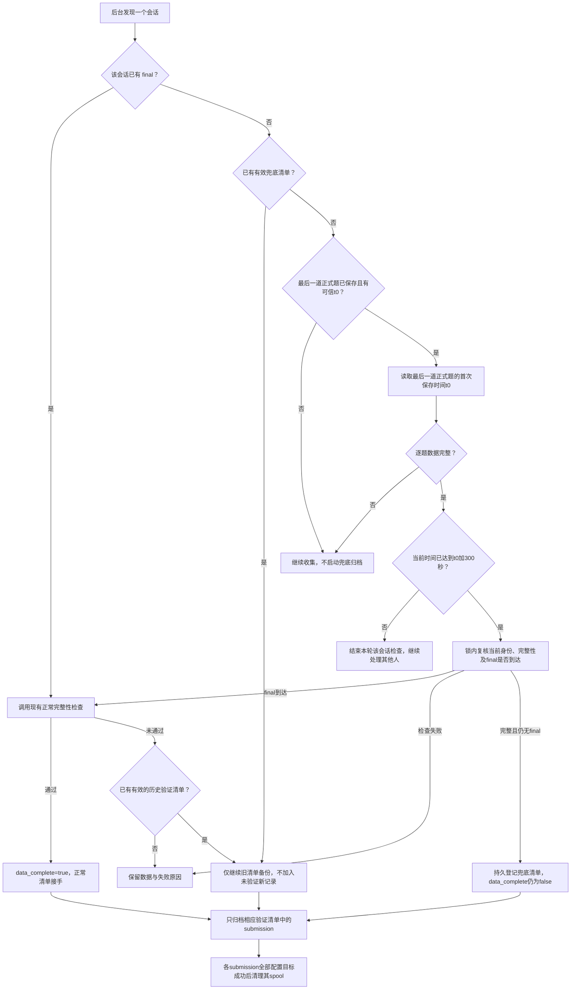

# VPS 缺少客户端 final 时的自动归档设计笔记

日期：2026-11-13（Europe/Berlin）

状态：设计记录，尚未实现或部署。2026-11-13 按 grill-me 方式逐项质询，并依据 receiver 源码修订。本轮授权范围是审查并修订笔记；本文补充现有 VPS 完整性判定流程，不替代正常 final 提交流程。

## 1. 问题与目标

存在这样的真实会话：VPS 已收到 metadata、教程和全部 24 个正式 trial，但没有收到客户端 final，因此后台不会自动传到坚果云和 Sciebo。题目已全部保存与客户端最终导出已保存是两件事。

目标：VPS 主动检查自己的持久数据；从该会话最后一道正式题的 Confirm 结果首次在 VPS 成功保存时起，给客户端 final 留出 5 分钟。到期仍缺 final 且 metadata、教程和全部正式题检查通过时，自动归档已收到的原始数据。多人同时作答时，每个会话独立等待、检查和归档。

本设计只涉及 receiver 数据管线。前端 UI、实验题目、刺激、评分、计时、Pause、页面地址、sequence 分配及中英文静态包不需要因本功能修改。

## 2. 已观察事实与证据边界

### 2.1 当前代码已具备的能力

| 能力 | 当前行为 | 本次处理 |
| --- | --- | --- |
| 持久接收 | `/submit` 校验后保存文件、SQLite、JSONL，完成持久化后确认接收 | 复用 |
| 身份绑定 | assignment 绑定 participant；请求与嵌入文件的身份必须一致 | 复用 |
| 幂等 | 相同身份、相同内容重复提交返回原记录；冲突内容被拒绝 | 复用 |
| 最终完整性检查 | `finalize_session()` 检查 metadata、教程、正式 trial 和 final CSV | 保留严格入口，提取可复用的逐题检查部分 |
| 后台扫描 | `ArchiveWorker` 调用 `retry_pending()`；生产扫描间隔约 30 秒 | 扩展候选发现与资格复核 |
| 双云归档 | 按目标记录成功或失败，跳过成功目标并重试失败目标 | 复用 |
| 清理 | 单份提交的所有配置目标成功后才删除其 spool | 保留 |
| 并发保护 | SQLite 事务、publication lock、按完整会话身份生成的 session lock | 复用，等待期间不持锁 |
| 重启恢复 | 已有接收、完整性及归档状态存于 SQLite | 扩展为也保存等待起点与兜底资格 |

当前 v2 后台归档入口要求 `data_complete=1`；迁移的 legacy 记录有单独兼容路径。新会话缺 final 时通常仍为 `collecting`，它不表示“VPS 已验证除 final 外完整”。目前没有独立的等待期限或无 final 自动兜底。

`final` 是经 `/submit` 上传的客户端最终 CSV/JSON 文件批次，至少包含 session CSV 与 raw-results CSV；`/archive` 才是请求检查和入队的指令。内部 `archive_session()` 是底层传输入口，本身不要求 final，也不替代完整性检查。

另一个代码事实：当前 `finalize_session()` 与网络归档使用同一个 session lock。跨会话不因此共用长锁，但迟到 final 的本地完整性请求可能等候自己会话的网络归档。新增兜底会增加这种交错机会，不能直接假定现有锁足以保证这条路径不受影响。

本轮自查还核实了以下实现细节，后文设计必须显式处理：

- `save_submission()` 的 `received_at` 在写文件及 fsync 之前生成，不是保存完成时间。
- `_retry_session_locked()` 会重新查询该会话的全部待归档记录；只给外层查询增加兜底标志，会把验证后才收到的文件夹带进来。
- `finalize_session()` 检查失败时目前将 `manifest_json` 写成 `{}`；不能直接用这条路径覆盖未来的兜底验证清单。
- `_insert_submission()` 对已有 finalization 行只更新 `updated_at`；新增 final 后，会话原有的 `archived` 状态可能暂时滞后。
- 正常完整性检查对 `complete` 有缓存返回；若已接受记录集合后来发生变化，不能继续把旧清单当作新集合的完整性证明。
- `ArchiveWorker` 目前只捕获整轮异常；一个会话的未处理异常可能使这一轮尚未处理的其他会话无法继续。

代码依据：

- `receiver/app/storage.py`：`save_submission`、`_validate_v2`、`finalize_session`、`_session_completeness_error`、`queue_archive`、`archive_session`、`retry_pending`、`_retry_session_locked`、`_session_lock_path`。
- `receiver/app/archive_worker.py`：现有 worker 循环。
- `receiver/app/server.py`：`/submit`、`/archive` 及 worker 构建。
- `receiver/app/config.py`：正式题数、教程要求、schedule version 和扫描间隔配置。

### 2.2 本会话先前的手动传输验证

目标会话：

```text
experiment_id: run_41_persistent
participant_id: P_20261112_194542_10ZP6LM
session_id: S_20261112_194542_1P946Z
sequence_id: 7
```

操作前记录：1 份 metadata、1 个教程 trial、24 个正式 trial，正式索引 1–24，final 为 0。手动直接调用现有内部归档函数后，坚果云与 Sciebo 各 26 条目标记录均为 `archived`，两家远端目录下各观察到 26 个 submission 目录，spool 按现有双目标成功规则清理。

该验证证明现有传输层能够归档没有 final 的已接收记录；它绕过了正常完整性门控，不证明自动兜底已经实现。原记录仍缺 final，未伪造客户端汇总，也未将 `data_complete` 改为 1。此前没有下载全部云端文件做逐字节比较。本轮写笔记没有重新连接 VPS 或重查该记录。

### 2.3 已运行的本地并发测试

2026-11-13，本会话使用项目 Pixi 环境的 Python 执行以下 7 项既有测试，结果为 `Ran 7 tests ... OK`，退出码 0：

```text
test_storage.StorageTests.test_allocate_assignment_is_unique_under_concurrent_requests
test_storage.StorageTests.test_v2_rejects_assignment_binding_and_embedded_identity_conflicts
test_storage.StorageTests.test_slow_archive_does_not_block_unrelated_session_submission
test_storage.StorageTests.test_archive_session_and_retry_pending_serialize_across_processes
test_data_pipe.ReliableDataPipeTests.test_session_rejects_cross_kind_assignment_changes_in_both_arrival_orders
test_data_pipe.ReliableDataPipeTests.test_cross_kind_assignment_is_checked_after_concurrent_preflight_validation
test_data_pipe.ReliableDataPipeTests.test_cross_kind_assignment_comparison_includes_every_persisted_field
```

其中并发分配测试使用 20 个线程，断言 participant number 与 rotation index 不重复；它不要求循环中的 sequence ID 永远不重复。以上是当前代码的局部回归证据，不是新增兜底或生产多人压力测试的通过记录。

## 3. 讨论结论与方案选择

讨论已明确的要求：

- A 等待自己的 final 时，B 可以独立上传 final 并正常完成；B 的行为不重置、结束或满足 A 的等待条件。
- 用户明确修正：五分钟从最后一道正式题完成后算起，不从实验开始、整体运行时长或后台首次扫描算起。服务端使用最后一道正式题结果首次成功保存的 UTC 时间作为可验证起点。
- 自动兜底须先确认逐题数据完整，不将未完成实验当作完成实验归档。
- 优先复用当前持久状态、worker、身份绑定、归档目标和重试机制。
- 正常 final 与缺 final 的兜底必须可区分，不伪造客户端文件。

回顾的三个选择：

| 选择 | 结果 | 结论 |
| --- | --- | --- |
| 后台无条件调用底层归档函数 | 可以传输，但可能把只做了一部分的会话也发布出去 | 不采用 |
| 检查逐题完整性，等待 final，到期复检后复用现有归档 | 解决本次遗漏，保留正常完成门控及原始文件 | 本笔记采用 |
| VPS 同时重建客户端全套 final CSV/JSON | 需要逐字段核对客户端专有会话信息与导出逻辑 | 不纳入本次设计 |

本笔记的设计参数为最后一道正式题保存后等待 300 秒。它与实验总时长、客户端最终请求的 90 秒超时、后台约 30 秒扫描间隔分别独立。保存设计笔记不代表已授权执行代码修改或生产部署。

## 4. 两种完整性含义必须分开

### 正常完成

保持 `data_complete=true` 的当前含义：metadata、教程、全部正式 trial、客户端 final 和 final CSV 一致性检查全部通过。`/archive` 的成功判定与客户端成功结束条件不放宽。

### 无 final 的兜底归档

仅表示逐题数据已经完整且允许将一份已验证清单中的原始记录传往云端。首次取得资格时保留 `data_complete=false`、`final_submission_id=null`，在 receiver 内部记录无 final 原因、验证清单和单独的兜底资格。

所以 `archive_status=archived` 可以与 `data_complete=false` 同时存在：收到的原始数据已备份，但客户端最终文件批次没有收到。这不能被展示或解释为已保存完全相同的客户端汇总文件。

若之后收到 final，`final_submission_id` 可记录其真实 ID；只有正常完整性检查通过才设置 `data_complete=true`。旧兜底清单可以继续重试自己的未完成目标，不因此取得上传新 final 的权限。

## 5. 等待、检查与归档流程



### 5.1 逐题完整性检查

检查范围始终限定在一个完整会话身份内，复用现有接收验证与完整性规则：

1. 服务端能够确定该会话 schedule version 对应的预期正式题数和教程要求；当前 Run 41 为 24 题。使用与该版本绑定的会话持久配置，不能将当前部署的 24 题配置套到其他历史版本，也不能从实际收到的题数或 final 行数反推预期数量。配置缺失、版本不一致时不启动新等待或授予新资格。
2. 恰好一份有效 metadata；其 participant、session、assignment 和 sequence 与会话一致。
3. 该会话版本的持久配置所要求的教程 trial 已收到。
4. 正式 trial 数量恰好为预期数量，索引恰好为 1–N（当前为 1–24），无缺失或重复。
5. 正式 trial 的 `trial_session_id` 和 `presentation_id` 非空且各自唯一。
6. 复用现有文件可用性判定；未归档文件必须有本地原始文件，已按现有规则归档并清理的文件允许使用已有归档状态和 URI 作为可用性依据。

这里检查的是已接受记录的结构完整性与身份一致性，不判断答案正确与否，也不新增刺激或评分解码流程。正式 presentation ID 的非空与唯一性检查，不等于逐项核对它是否正好位于该 sequence 的指定位置；本功能不能据此声称新增了顺序真实性验证。现有代码的“文件可用”检查也不等同于重新下载远端文件并逐字节复核。

### 5.2 等待时间：严格从最后一道正式题保存后算起

定义 `N` 为服务端配置的预期正式题数，当前 Run 41 为 24。最后一道正式题固定为该会话的 `trial_type=formal` 且 `trial_index=N`，不是“最近收到的任意一个请求”。

```text
t0 = 该会话第 N 道正式题 Confirm 结果首次在 VPS 成功保存的服务端 UTC 时间
deadline = t0 + 300 秒
首次授予兜底资格 = 没有 final 且逐题完整性检查通过且可信 t0 存在且当前时间 >= deadline
```

- 第 N 道正式题的原始文件和 manifest 完成 durable 写入后，在发布该 submission 的同一 SQLite 事务中生成并首次写入 `final_wait_started_at=t0`。该时间属于这一笔成功提交的服务端接收记录，不追求精确到 fsync 完成的硬件时刻。事务提交失败或请求被拒绝，不能留下有效 t0；只有事务成功后才承认起点。不得复用写文件前生成的旧 `received_at`。
- t0 与第 N 道正式题的有效记录必须一起持久存在；重启后不能出现“有起点但没有对应正式题”仍可触发归档的状态。JSONL 在数据库提交后更新；若其更新中断，沿用现有对账恢复，不重新建立 t0。
- 前端没有新增报时请求。服务端不能观察离线的实际鼠标点击时刻，因此以 VPS 成功保存结果的时刻为准；网络晚到会延后服务端等待起点。
- 不使用实验开始时间、metadata 时间、教程时间、`session_finalizations.created_at`、`updated_at` 或“实验总时长已超过五分钟”触发兜底。
- 第 1–23 题、教程、metadata 的保存不能代替第 24 题建立起点。没有最后一道正式题时，无论实验已运行多久，都不能触发兜底。
- 第 24 题相同内容的重试、其他题的补传、其他被试提交以及服务重启，均不重置该起点。
- 同索引但不同 `trial_session_id` 的额外记录不能建立第二起点，也不能越过正式题数量与索引唯一性检查。
- 即使第 24 题先到、前面的某题或 metadata 晚到，也只从第 24 题的首次成功保存时间计时；检查未完整时禁止归档，之后补齐也不重新开始五分钟。
- 等待只是一条数据库记录；不得 `sleep(300)`、持续持有会话锁或全局锁。
- 第 299 秒不能触发，第 300 秒开始才允许进入复检；扫描与现有归档排队可能使实际启动更晚。
- 解析并比较带时区的 UTC 时间，不使用本地时区或字符串顺序。起点格式损坏时保留错误、不猜时间；当前时间早于 t0 时继续等待。该五分钟以 VPS 的 UTC 时间差为准，依赖服务器时钟正常，不能宣称能抵御任意系统时钟跳变。

历史缺少可信 t0 的处理：现有 `received_at` 生成于 durable 写入前，`created_at`、`updated_at`、首次扫描时间也不能证明最后一道题何时保存完成。因此迁移不自动推算历史起点，不在幂等重传时补写一个新起点；此类会话列入人工恢复对象，仍可走已验证的手动归档流程。历史行只有在存在可核实的保存完成时间证据时，才可经单独维护操作恢复；本轮未发现可直接自动回填的这类证据。

例：实验于 14:00 开始，第 24 题结果于 14:42 成功保存，最早在 14:47 才有兜底资格。不能因为实验在 14:05 已运行五分钟就触发，也不能在 14:43 首次扫描时把起点改成 14:43。

### 5.3 到期复核

候选查询只是发现工作，不能直接赋予归档资格。首次授予资格前，在该 session lock 下使用短 publication 临界区，复核完整三元身份、版本配置、可信 t0、到期条件、逐题完整性及 final 是否已到达；随后在同一控制事务中保存验证清单和资格。

清单复用现有 `manifest_json`，至少绑定完整会话身份、schedule version、预期题数、最后一道正式题 ID、t0、验证时间，以及逐一对应的 `submission_ids` 与 `content_sha256`；另标记来源为 `missing_client_final`。它是 receiver 内部验证证据，不另造上传文件或客户端 CSV。

归档执行必须显式消费该清单中的 ID，只处理其中尚未成功的目标。必须收窄现有 `_retry_session_locked()` 的重新查询范围，不能只在外层 SQL 添加 `OR fallback_archive_ready=1`，然后继续选择整个会话的全部 pending 文件。每次重试核对清单中的身份及记录绑定；缺文件、清单损坏或内容绑定不符时记录错误并停止相应传输，不扩大清单来凑齐数量。

网络传输在释放全局 publication lock 后执行，继续由该 session lock 串行保护。扫描期间新接受的记录不能未经检查自动混入当前或下轮旧兜底清单。网络失败不撤销已取得的清单资格；重启后从相同清单与每目标状态续传。

每目标“成功则不再传”指成功状态已经持久记录。若云端已写入而进程在记录成功前退出，恢复后允许对同一 submission ID、同一目标路径重试相同原始字节；复用现有固定路径及幂等记录，不承诺网络操作严格只执行一次，也不因此生成新 submission 或新归档目录。

若 final 已到，即使浏览器没有再调用 `/archive`，后台也调用正常完整性检查；检查失败时保留错误和文件，不能新授予无 final 资格将无效 final 当作有效完成。此前已验证的旧兜底清单按 5.5 节继续自己的备份。

### 5.4 状态的最小扩展

在现有 `session_finalizations` 中增加两个独立的内部控制字段：

- `final_wait_started_at TEXT NULL`：该会话最后一道正式题首次成功保存的服务端 UTC 时间；当前 Run 41 对应第 24 题。
- `fallback_archive_ready INTEGER NOT NULL DEFAULT 0`：是否存在经到期复检取得、尚由兜底路径负责的原始数据验证清单；不是给该会话所有未来文件的通行标志。

`awaiting_final`、`archive_ready_without_final` 仅是从新字段和清单派生的内部描述，不写成新的公开 `finalization_status` 枚举。保留现有 `collecting`、`incomplete`、`needs_recovery`、`complete` 约定；归档进度仍使用原有 `archive_status`。正常 API 返回 `data_complete=true` 的条件不读取兜底标志。

后台在原有正常完成及 legacy 路径之外，增加经过复检的兜底资格分支。缺 final 的 `/archive` 请求仍返回现有 HTTP 409、`data_complete=false`，不得因为内部状态命名变成 503 或成功响应，也不得清除旧兜底清单。正常检查失败必须保留已有清单，不能沿用当前将 `manifest_json` 写成 `{}` 的行为。

首次授予资格时，清单与标志必须在同一数据库事务中提交。崩溃后不能出现标志为 1 却无验证清单仍可上传的状态。正常检查通过时，以包含 final 的正常清单接手并清除兜底标志；单次云端失败或 final 检查失败不执行此转换。

新字段采用可重复执行的向后兼容迁移，历史行默认 `t0=NULL`、兜底资格为 0；历史处理遵循 5.2 节，不用近似时间填值。原有正常完成记录与 legacy 兼容资格不被重写。

### 5.5 迟到 final

- final 继续走原有 `/submit` 校验与幂等机制。
- 请求因身份、内容或格式冲突在接收阶段被拒绝时，它不是“已收到 final”，不改动等待起点、验证清单或归档资格。
- 接受一份新 final 时，保留此前取得的原始数据清单及各目标状态；新 final 必须通过正常完整性检查，不能自动加入旧清单。
- 若 final 在兜底传输中到达，本轮只处理已验证的原始快照；新 final 留在待处理状态，下一轮正常检查后再归档。
- 即使逐题 spool 已按双云成功规则清理，仍须利用现有“跳过已归档文件”的路径接受和补传 final。
- final 通过正常完整性检查后，升级为正常 `complete`、`data_complete=true`；在同一控制事务中写正常验证清单、清除兜底标志。相同 final 重试不生成第二份记录。
- 若 final 已接收但检查不通过，保留失败原因与该文件，不报告正常完成，也不归档未验证 final；此前有效清单中尚未完成的原始备份仍继续。否则会出现“坚果云已成功、Sciebo 待重试，却因迟到坏 final 永远停传”的漏洞。
- 若在取得兜底资格之前已经收到不完整 final，不新建兜底资格绕过正常检查；保持正常失败与维护恢复路径。
- 本地 final 完整性确认不得等待该会话的网络归档长锁。复用短 publication 临界区取得并验证持久快照，保留正常检查及响应条件；归档快照仍由原有 session lock 保护。实施时须验证上传与本地检查的并发交错，不能仅复跑跨会话测试就宣称此项通过。

### 5.6 新记录与会话状态一致性

新增记录接受成功时，必须按该会话当前所有 submission 的归档状态同步更新会话 `archive_status`。例如旧的 26 份原始提交均已双云成功，而新 final 仍 pending，此时会话不能继续报告“全部已归档”；旧成功目标不能被重置或重复传输。

会话归档状态的读取与回写须在同一短控制临界区完成，与接收新记录的状态更新串行。不能仅在接收端重算一次，却允许后台先读到“全 archived”、等 final 插入后再把旧计算结果覆盖回去。复用现有 publication lock 与事务，不在该临界区执行网络传输。

正常 `complete` 的缓存也必须绑定其已验证 submission 集合。幂等重复不影响缓存；真正新增的记录不能借用旧 `data_complete=1` 或旧清单直接归档，应先重新检查当前集合。检查失败不清除既有兜底证据，也不改变已经成功归档的原始字节。没有新记录的正常流程保留现有响应。

同一原则也适用于“正常检查曾通过，之后出现额外记录”：保留最后一次有效的正常清单，允许其自身尚未完成的目标继续重试；当前集合检查失败则 `data_complete=false`，新增记录继续隔离。否则只使 complete 缓存失效、却停止原有已验证记录的重试，会重现迟到坏 final 导致停传的问题。复用同一 `manifest_json` 保存最后一次有效清单，不另加一套历史清单；正常成功时新清单接手，失败时不覆盖旧清单。旧清单的传输资格不能被解释为当前集合通过检查。

### 5.7 发现与错误隔离

后台候选发现须覆盖“已有 final 但未完成正常检查”和“有可信 t0 且尚未完成兜底检查”的 v2 会话，不能只扫描已经 `data_complete=1` 的记录。等待未到期时结束该会话本轮工作，不阻塞 worker；到期后缺题的会话在以后扫描中仍可补齐并复检。

已经持久取得的有效清单仍属于重试候选，即使当前集合因后来新增记录未能通过检查。初次授予资格须检查整个会话；续传旧清单则只验证其原有绑定，不让新记录扩大或抹除此前已验证的备份范围。

每个会话的发现后检查、清单读取及传输异常均记录完整会话键和原因，并继续处理其余会话；不能只依赖 worker 最外层的整轮异常捕获。涉及既有 spool 对账清理的逐会话工作也要保留此边界。数据库整体不可用时可结束本轮并报告错误，不把它吞成成功。复用现有日志及目标失败状态，不新增监控系统或上传线程池。

后台 worker 与 `retry_archive.py` 维护命令共用同一资格、清单和锁规则；命令不因绕开 worker 包装而绕过完整性或五分钟门控。

## 6. 多人同时作答的隔离要求

所有等待、检查、状态更新、失败原因和归档任务都使用完整键：

```text
(experiment_id, participant_id, session_id)
```

不得仅按 sequence、participant number、Prolific ID、最后收到的 final 或进程内的“当前被试”变量工作。相同 sequence 是顺序复用，不是会话复用。

例如：A 已齐全，等待 final；B 正常完成并上传 final；C 仍只完成一半。B 通过自己的检查后正常结束，A 的等待起点保持原值，C 不满足兜底条件。A 的 12 题与另一人的 12 题不能合并成完整 24 题。

需要两种锁的归档路径保持 session lock → 短 publication lock 的顺序，不引入反向嵌套。B 的本地提交与检查不等待 A 的五分钟期限，也不等待 A 的网络长锁。双方仍共享 VPS 磁盘、数据库写入资源和云端上传带宽，因此隔离不等于无限并发或零排队：现有单 worker 正在上传 A 时，B 的云端上传可以排队，但这不应延迟 B 的本地成功确认。本次不增加并行上传池。

本地完整性确认仅使用短控制临界区，不能在持有 publication lock 时再等待归档 session lock，也不能在已持有 session lock 时重入会再次获取同一锁的公共包装。共享检查逻辑须与其锁包装分开复用。

## 7. 保持正常 pipeline 的约束

1. 正常 `/submit final` → `/archive` → 完整性通过 → 后台归档的检查与响应条件保持。
2. 现有 trial、metadata、tutorial、final 文件的字节、文件名、归档路径和身份字段保持。
3. 不创建虚假的客户端 final，不生成另一套恢复 CSV，不把服务器观察时间当作浏览器实验结束时间。
4. `data_complete` 与双云归档状态继续分别表达本地完整性和云端传输进度。
5. assignment 分配、正式 sequence slot、补位和开发者隔离不变。正式与开发者会话采用相同检查及传输规则。
6. 不因为 A 的兜底扫描而更新 B 的时间、状态、文件或归档目标。
7. 原有每目标成功状态、失败重试和双目标成功清理规则保持。
8. 部分会话不因本次功能自动归档；已归档历史记录不补造 final 或人口信息。

## 8. 预计实施落点

| 位置 | 必要工作 |
| --- | --- |
| `receiver/app/storage.py` | 提取共享逐题检查、兼容迁移、成功接受最后一道正式题时持久记录 t0、清单与资格原子提交、只执行清单 ID、迟到 final 与旧备份续传、同步会话状态及本地检查避开网络长锁 |
| `receiver/app/archive_worker.py` / `retry_pending()` | 将候选复核接入原有循环；在逐会话工作边界隔离错误，保持非阻塞等待和原有归档执行 |
| `receiver/app/server.py` | 核查共用 storage 的构建及现有状态枚举、409/202/200 响应回归；本次不增加公开接口 |
| `receiver/app/retry_archive.py` | 核查维护命令读取持久版本配置，并与后台使用相同资格及清单，不绕过新判断 |
| `receiver/tests/test_storage.py` | 等待与迁移持久化、正常门控、迟到 final 续传、快照竞态、状态缓存和身份隔离 |
| `receiver/tests/test_data_pipe.py`、`test_server.py` | 双云原始字节、正常响应、故障重试、完整工作流与多人交错回归 |
| `receiver/README.md` | 记录最后一道正式题保存后 300 秒的等待含义、缺 final 状态及恢复边界 |

最后一道正式题保存后的 300 秒作为本功能固定等待常量，不为本次增加调参配置或新依赖。复用现有扫描间隔配置。只有实施调查证明现有 worker 调用点需要调整时才修改该文件，不为列出文件而制造空改动。

## 9. 实施后必须通过的验收

下列均为新增或重跑要求，不是已通过声明。

| 场景 | 必须观察到的结果 |
| --- | --- |
| 正常 metadata＋教程＋24 trial＋final＋`/archive` | 原有成功条件、文件字节、目录、身份及归档结果不变 |
| 实验已开始超过五分钟，但尚无第 24 题 | 不从整体时长计算等待，不发生兜底归档 |
| 第 24 题首次保存后 299 秒；实验此前已运行很久 | 不发生兜底云端调用，`data_complete=false` |
| 第 24 题首次保存后达到 300 秒且复检通过 | 原始记录进入双云归档，保留缺 final 标记 |
| 第 24 题写文件或发布事务失败，或接收被拒绝 | 不留下有效 t0 或兜底资格；有效重试后才能首次建立起点 |
| 第 24 题保存后，后台延迟扫描、重复补传或其他人提交 | 起点始终等于第 24 题首次保存时间，不改为扫描或最近请求时间 |
| 第 24 题先到，其他正式题或 metadata 晚到 | 未齐全时不归档；补齐后沿用第 24 题起点，不额外重等五分钟 |
| 少一题、缺 metadata/教程、重复正式索引、身份冲突、原始文件缺失 | 不取得兜底资格，保留数据与原因 |
| 服务重启或重复请求 | 等待起点不重置，不重复创建 submission 或占用 sequence slot |
| 历史已有第 24 题但缺少可信 t0；迁移重复执行 | 起点保持 NULL、资格关闭，不用旧 received_at、扫描时间或幂等重传补造起点；旧 complete/legacy 不变 |
| schedule version 不匹配、预期题数/教程要求缺失、t0 损坏或当前时间早于 t0 | 不套用当前 24 题配置、不提前归档，记录可定位原因 |
| 资格提交前后进程退出 | 清单与资格同时存在或同时未提交；恢复不能凭空标志归档 |
| final 在等待中到达 | 无需等满 300 秒，走正常完整性检查 |
| final 已到，但浏览器未调用 `/archive` | 后台执行正常检查，通过后归档 |
| final 在到期复核、归档中或 spool 清理后到达 | 不丢新增文件，不绕过 final 检查；已成功目标不重复上传 |
| 同一会话的兜底云上传被阻塞时，final 到达并请求 `/archive` | 本地接收与完整性确认不等网络释放，且检查结果与归档快照一致 |
| 坚果云已成功、Sciebo 失败时收到不能通过检查的 final | 原始清单对 Sciebo 继续重试；不归档新 final、不清旧清单、不报正常完成 |
| final 请求在接收阶段因冲突被拒绝 | 不视作已收到 final，不改变 t0 或旧清单 |
| 尚未取得兜底资格便收到不能通过检查的 final | 不新授予兜底资格绕过正常失败 |
| 外层候选读取后、实际执行前收到新 final 或额外 trial | 归档执行严格限定已验证 ID，未验证新文件不会混入 |
| 旧原始清单已归档，新 final 接受但仍待传 | 会话状态不再是 archived；正常检查通过才归档新 final，旧目标不重传 |
| 后台计算归档状态与接受迟到 final 在读写之间交错 | 旧计算结果不能覆盖新 final 的 pending 状态；控制事务结束后 aggregate 与现有记录一致 |
| 正常 complete 后收到真正新增的记录；另做幂等重传对照 | 新集合不能套用旧缓存；幂等重复保持原记录及既有状态 |
| 正常清单仍有目标待传，后来新增记录导致当前集合检查失败 | 当前 data_complete=false，旧有效清单仍续传，新增记录保持隔离，不擦除既有证明 |
| 缺 final 时调用 `/archive`，包括已有兜底资格的会话 | 仍为 HTTP 409/data_complete=false；不变 503 或成功，不损坏旧清单 |
| 坚果云或 Sciebo 单边失败、归档进程重启 | 成功目标保持，失败目标可重试，未双目标成功的 spool 保留 |
| 云端写入成功、数据库登记成功前进程退出 | 重试仍使用原 submission ID、路径与字节，不制造第二份提交或额外归档目录 |
| 两个进程同时处理同一兜底清单 | 现有会话锁串行保护，已登记成功的目标跳过，清理与迟到 final 互不损坏 |
| A 的清单解析或逐会话工作抛异常，B 数据正常 | A 有可定位错误，B 在同轮仍能被处理；不能将 A 的异常报成成功 |
| A 等待、B 正常提交、C 未完成 | 各人的等待、完整性、归档资格和文件完全独立 |
| A 12 题＋B 12 题 | 两人都不构成完整 24 题 |
| 不同 participant 使用相同 session ID；相同 participant 使用不同 session ID；不同人相同 sequence | 仍按完整三元键区分，不合并记录 |
| 正式与 developer/debug | 数据规则一致，debug 身份与正式 assignment/slot 继续隔离 |
| A 归档网络被人为阻塞 | B 仍能完成本地接收和正常完整性确认，不等待 A 的网络 I/O |
| 同一组 fixture 分别经 worker 与维护重试命令处理 | 资格、清单选集、状态和每目标结果一致；未到期或不完整记录均不被绕过 |

测试先使用可控时钟、隔离临时数据库和两个本地 archive backend，比较每份归档文件的原始字节；不在生产制造虚假被试或消耗正式 slot。复跑完整 receiver 测试，再在后续获授权部署时对 VPS 做隔离验证。

部署与回滚时需保留 SQLite、JSONL、spool 以及既有归档证据。旧版 receiver 不识别兜底资格，回滚后此类任务可能暂停；部署记录须列明待处理会话，不能把“旧版服务能启动”当作兜底任务继续执行的证明。

## 10. grill-me 自查记录

以下为本轮逐项质询。源码事实与设计修订分列；“已修订”仅表示写入本文，不表示代码修复或测试已通过。

| 质询 | 源码或设计证据 | 本轮修订与关闭条件 |
| --- | --- | --- |
| 五分钟是否可能从整场实验、首次扫描或任意补传算起？ | 多个旧时间字段含义不同；用户要求最后一道正式题之后才计时 | 5.2 固定第 N 题成功接受的独立 t0，重复请求不改；以 299/300 秒、晚到及重启测试关闭 |
| 旧 received_at 是否真是落盘完成时间？ | `save_submission` 先生成时间，再写文件/fsync | 禁止自动历史回填；新事务记录独立起点，失败无起点；历史无证据走人工恢复 |
| 清单和资格是否可能只保存一个，重启后放行？ | 新资格将成为持久门控，单独写入会产生半状态 | 5.3–5.4 要求同事务；用进程退出点测试验证 |
| 是否只改候选 SQL，实际仍传整场全部 pending 文件？ | `_retry_session_locked` 当前重新 SELECT 全会话 | 执行显式限定验证 ID，注入迟到 final/额外 trial 证明未被夹带 |
| 迟到坏 final 会不会使另一朵云永远不再重试？ | 若接收即清兜底标志，而正常检查失败，两条资格都关闭 | 5.5 保留旧清单续传，仅隔离未验证 final；单云失败与迟到坏 final 联合测试关闭 |
| `/archive` 失败是否会擦掉兜底证明？ | 当前失败路径把 manifest 写为 `{}` | 5.4 明确保留已验证清单；重复失败请求后验证清单和重试资格不变 |
| 原始数据已归档后收到 final，是否仍误报全部 archived？ | `_insert_submission` 已有会话仅更新 updated_at；后台 aggregate 也有读后写 | 5.6 在相同短控制边界内同步 aggregate，防止旧计算覆盖；测试 pending 及读写交错 |
| complete 缓存会否覆盖后来增加的记录？ | 正常检查可直接返回既有 complete | 缓存绑定记录集合，新增须重检、重复不变；旧有效清单继续自身重试，未验证新增文件不能沿用旧资格 |
| 新状态名是否让前端从 409 变成 503？ | server 对 incomplete/needs_recovery 映射 409，其余失败映射 503 | 状态名只作内部描述；缺 final 的 HTTP 契约不变，以 server 回归证明 |
| 迟到 final 是否需要等云上传完才得到本地确认？ | finalize 与上传当前使用同一 session lock | 5.5–6 拆开本地短检查与网络长锁，单独做同会话阻塞交错测试 |
| A 的异常或等待是否卡住 B？ | 当前仅整轮 except；单 worker 顺序传输 | 5.7 逐会话错误隔离；不持锁等待五分钟；区分 B 本地确认与云端排队 |
| 新旧 schedule、debug 和维护命令是否同规则？ | N/教程要求持久在会话中；维护命令也调用 retry_pending | 版本绑定，不用当前配置覆盖旧版；同 fixture 验证两个入口与 debug 隔离 |
| 是否误把“数据完整”说成“答案正确且顺序已逐项核实”？ | 当前主要检查身份、计数、索引及唯一性 | 5.1 明确能力边界，不额外声称评分或 schedule 内容校验 |
| 云端归档能否补出浏览器从没发来的字段？ | 手动验证只传输了 metadata 与逐题原始记录 | 保留 missing-final 含义，data_complete=false，不伪造 CSV 或客户端结束时间 |
| 云端成功后立刻断电，是否真的能保证从不重传？ | 云端写入与本地成功登记不是一个原子事务 | 允许恢复后以相同 ID、路径和字节重试；以退出点和双进程测试证明不生成额外提交 |

## 11. 自审结论与未验证事项

设计层面已修正计时证据、历史迁移、迟到 final 中断续传、验证与执行选集竞态、状态滞后、缓存失效、HTTP 兼容和逐会话异常隔离等疏漏；对应关闭条件已列入第 9 节。没有新增 worker 池、公开接口、前端请求、依赖或独立重建 CSV 系统。

本轮核对的是本地源码和设计一致性，没有实施 receiver 修改，没有重连 VPS、提交 Git、推送或部署。自动兜底及新增交错场景仍须按第 9 节实现并测试；第 2 节的既有 7 项测试不能替代这些验收，也不能外推为生产压力测试通过。

保留两个实际边界：历史缺可信 t0 的会话不自动猜起点，需要单独恢复；缺 final 时能保存的是已收到的原始数据，不能补回浏览器从未上传的最终汇总或专有会话字段。五分钟是触发资格门槛，扫描、云端排队或故障重试会使备份完成更晚。

下一阶段是基于本文形成具体实施与测试计划，再进行代码修改和 receiver 部署；本次仅完成笔记自查与修订。
